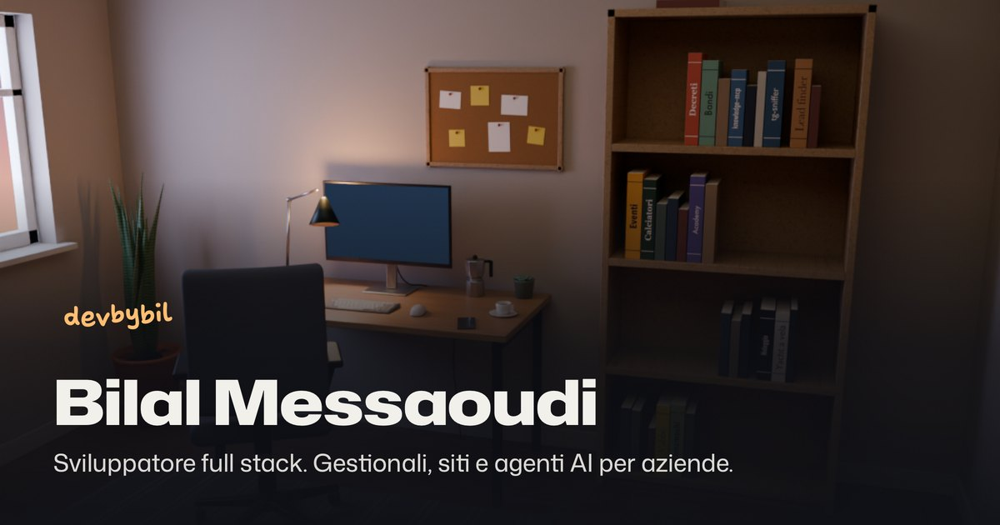

<p align="center">
  <a href="https://bilalmessaoudi.it">
    
  </a>
</p>

# Bilal Messaoudi, sviluppatore full stack

Il sito portfolio di Bilal Messaoudi (devbybil), sviluppatore full stack freelance: gestionali, siti e agenti AI per aziende.

**Sito live: [bilalmessaoudi.it](https://bilalmessaoudi.it)**

La pagina è costruita attorno a una stanza di lavoro in 3D. Scorrendo, la camera si muove tra le sezioni (presentazione, lavori, stack, metodo, chi sono, contatti) e la stanza passa da sfondo a tutto schermo a finestra accanto al testo. Gli oggetti sulla scrivania e i libri sullo scaffale si possono cliccare: ogni libro è uno dei progetti e apre la sua scheda, e i loghi sui poster alle pareti portano la camera sulla tecnologia corrispondente. Se il dispositivo non supporta WebGL, il resto del sito funziona lo stesso.

Il sito è in italiano (`/`) e in inglese (`/en`).

## Stack

- **[Next.js 16](https://nextjs.org) (App Router) e React 19**, in TypeScript.
- **[Tailwind CSS 4](https://tailwindcss.com)** per lo stile, con i font Mona Sans, Hubot Sans, Shantell Sans e IBM Plex Mono caricati da `next/font`.
- **[three.js](https://threejs.org)** per la stanza: un modello glTF compresso con Draco, caricato in versione ridotta sugli schermi piccoli. Tutte le superfici sono texture non illuminate, perché la luce è già cotta nelle texture: niente luci né ombre in tempo reale, stesso aspetto su ogni dispositivo. Un fotogramma viene disegnato solo quando qualcosa si muove.
- **[Blender](https://www.blender.org)**, guidato da uno script Python, per costruire la stanza, illuminarla con Cycles e fare il bake della luce nelle texture.
- **Script Node** (con `sharp`, `simple-icons`, `d3-geo` e `world-atlas`) che generano dai contenuti del sito i poster delle tecnologie, la mappa del mondo e i titoli sui dorsi dei libri.
- SEO di base generata dal codice: metadati Open Graph, dati strutturati schema.org, `sitemap`, `robots` e manifest.

## Struttura

```
app/              Route del sito: (it) per l'italiano, (en)/en per l'inglese,
                  più icone, manifest, sitemap e robots
components/       Componenti React: la pagina, le sezioni, la scheda progetto, l'header
lib/content/      Tutti i contenuti: testi in due lingue, progetti, tecnologie, poster
lib/scene/        La scena three.js della stanza (camera, interazioni, animazioni)
blender/          Script che costruiscono la stanza 3D e le sue texture (non fanno parte del sito)
public/models/    La stanza esportata da Blender (room.glb e room-mobile.glb)
public/draco/     Il decoder Draco usato da three.js per leggere i modelli
public/projects/  Le immagini dei progetti mostrate nelle schede
```

I contenuti stanno tutti in `lib/content/`: progetti, testi e tecnologie si modificano lì e il sito li legge da un solo punto.

## Avviarlo in locale

Serve Node.js e [pnpm](https://pnpm.io) 11.

```bash
pnpm install
pnpm dev        # http://localhost:3000
```

Altri comandi:

```bash
pnpm build      # build di produzione
pnpm start      # serve la build
pnpm lint       # ESLint
```

L'URL canonico del sito viene da `NEXT_PUBLIC_SITE_URL` (o da `VERCEL_PROJECT_PRODUCTION_URL` su Vercel). Se manca, si usa l'indirizzo di produzione, quindi per lo sviluppo non serve nessuna variabile d'ambiente.

## Rigenerare la stanza 3D

Il modello in `public/models/` è già nel repository: questi passaggi servono solo se cambiano i progetti, le tecnologie o la stanza stessa. Gli script `.mts` girano direttamente con una versione di Node che esegue TypeScript senza compilazione (22.18 o successiva), dopo `pnpm install`.

```bash
node blender/export-books.mts   # titoli e colori dei libri da lib/content/projects.ts
node blender/export-tech.mts    # poster delle tecnologie da lib/content/posters.ts
node blender/export-map.mts     # la mappa del mondo appesa alla parete

# costruisce la stanza, fa il bake e scrive public/models/room.glb e room-mobile.glb
/Applications/Blender.app/Contents/MacOS/Blender -b --factory-startup -P blender/room.py
```

`room.py` accetta anche `--preview` (rende le inquadrature della camera in `blender/out/` invece di fare il bake), `--res`, `--samples` e `--ss` per regolare dimensione e qualità delle texture. I dettagli sono in testa allo script.

## Contatti

- Sito: [bilalmessaoudi.it](https://bilalmessaoudi.it)
- LinkedIn: [Bilal Messaoudi](https://www.linkedin.com/in/bilal-messaoudi-877a6a183)
- GitHub: [@bmessaoudi](https://github.com/bmessaoudi)
